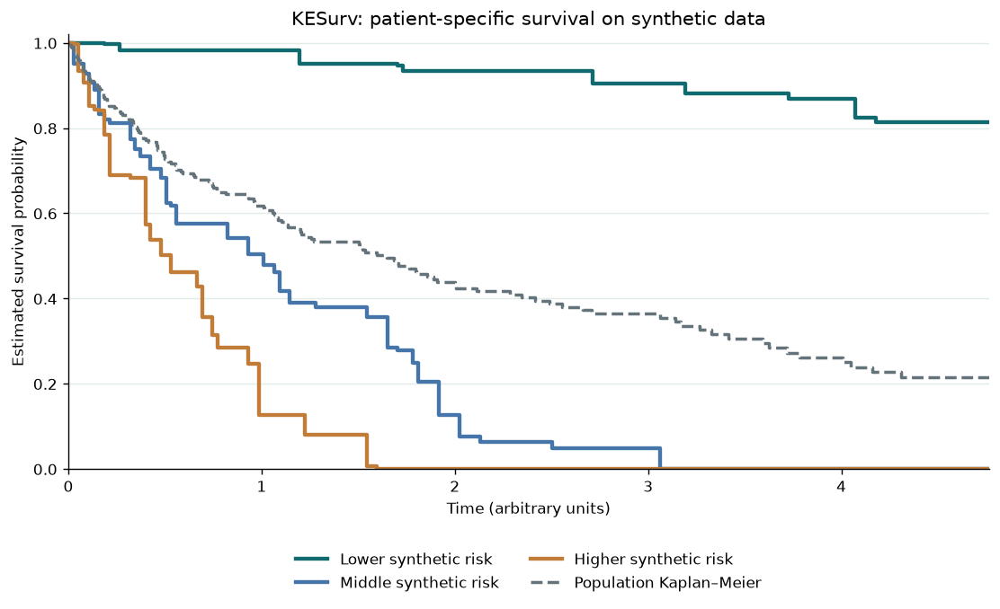

# KESurv

<div class="ks-hero">
  <div class="ks-eyebrow"><span>v0.1.0</span> Kernel ensemble survival estimation · <a href="https://arxiv.org/abs/2610.06434">arXiv:2610.06434</a></div>
  <p class="ks-display">Survival curves,<br><em>grounded in local evidence.</em></p>
  <p class="ks-lead">A survival forest proposes neighbors, your own models vote on which of them look alike, and a weighted Kaplan–Meier estimator turns the chosen neighbors into a patient-specific curve.</p>
  <div class="ks-actions">
    <a class="ks-btn ks-btn-solid" href="getting-started.html">Get started</a>
    <a class="ks-btn ks-btn-ghost" href="concepts.html">How it works</a>
    <code class="ks-install">$ pip install kesurv</code>
  </div>
</div>

<div class="ks-features">
  <a class="ks-card" href="custom-estimators.html">
    <svg viewBox="0 0 24 24"><rect x="3" y="3" width="7" height="7" rx="1.5"/><rect x="14" y="3" width="7" height="7" rx="1.5"/><rect x="3" y="14" width="7" height="7" rx="1.5"/><path d="M17.5 14v7M14 17.5h7"/></svg>
    <h3>Bring any learner</h3>
    <p>Anything with <code>fit</code> and <code>predict_survival_function</code> can vote, whether from scikit-survival or your own class.</p>
  </a>
  <a class="ks-card" href="predictions.html">
    <svg viewBox="0 0 24 24"><circle cx="11" cy="11" r="6.5"/><path d="M16 16l5 5"/><path d="M8 11h6M11 8v6"/></svg>
    <h3>Inspect every curve</h3>
    <p>Forest weights, agreement counts, selected neighbors and fallbacks are all returned, not hidden.</p>
  </a>
  <a class="ks-card" href="performance.html">
    <svg viewBox="0 0 24 24"><path d="M3 12h4l3-7 4 14 3-7h4"/></svg>
    <h3>Tune the cost</h3>
    <p>Choose the similarity horizon, grid resolution, batch size, and NumPy or Numba kernels.</p>
  </a>
</div>

## How a prediction is made

<ol class="ks-steps">
  <li><b>Forest</b><span>Leaves of a random survival forest give bootstrap-weighted candidate neighbors.</span></li>
  <li><b>Curves</b><span>Each base model predicts survival curves for the query and every candidate.</span></li>
  <li><b>Vote</b><span>A model votes for a candidate when the area between their curves is at most ε.</span></li>
  <li><b>Estimate</b><span>Candidates with enough votes feed a weighted Kaplan–Meier curve.</span></li>
</ol>

## Quick example

```python
from kesurv import KESurv
from sksurv.ensemble import RandomSurvivalForest
from sksurv.linear_model import CoxPHSurvivalAnalysis
from sksurv.tree import SurvivalTree

model = KESurv(
    base_estimators=[
        ("cox", CoxPHSurvivalAnalysis(alpha=1.0)),
        ("tree", SurvivalTree(max_depth=4, random_state=7)),
    ],
    forest=RandomSurvivalForest(n_estimators=100, random_state=7),
    epsilon=0.05,
    min_agreement=1,
    random_state=7,
).fit(X_train, y_train)

model.predict_survival(X_test, times=[1.0, 2.0, 3.0])  # (n_test, 3) probabilities
model.predict_neighbor_info(X_test[:1])                 # which neighbors, and why
```

`X` is a finite numeric matrix and `y` a scikit-survival structured array (`Surv.from_arrays`). [Getting started](getting-started.md) has a complete runnable version. Install `kesurv[speed]` for the optional Numba kernels. Python 3.10 or newer is required.

<figure class="ks-figure">
  
  <figcaption>Three patient-specific curves against the population Kaplan–Meier curve, from the <a href="synthetic-demo.html">synthetic notebook</a>.</figcaption>
</figure>

## Citation

<div class="ks-cite">Rahul Goswami. KESurv: A Kernel Ensemble Method for Patient-Specific Survival Prediction. <i>arXiv preprint</i> <a href="https://arxiv.org/abs/2610.06434">arXiv:2610.06434</a>, 2026.</div>

```bibtex
@misc{goswami2026kesurvkernelensemblemethod,
      title={KESurv: A Kernel Ensemble Method for Patient-Specific Survival Prediction},
      author={Rahul Goswami},
      year={2026},
      eprint={2610.06434},
      archivePrefix={arXiv},
      primaryClass={stat.ML},
      url={https://arxiv.org/abs/2610.06434},
}
```

```{toctree}
:hidden:
:caption: Guide

getting-started
concepts
predictions
custom-estimators
synthetic-demo
performance
```

```{toctree}
:hidden:
:caption: Reference

api
faq
contributing
```
